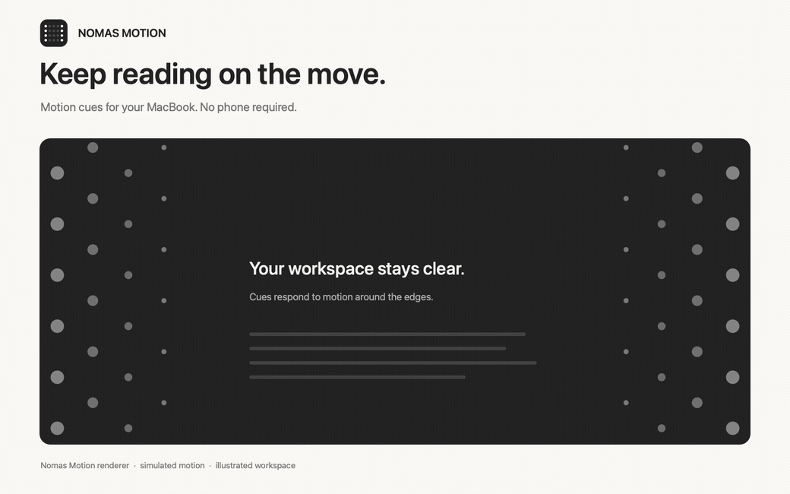

# Nomas Motion



[Install](#install) · [Why Nomas](#why-nomas-motion)

Reading on a bus can feel awful. Your body feels the turns and bumps, but the page on your laptop stays still.

Nomas Motion gives your eyes a small moving reference while you read or work. Dots respond to the movement of your MacBook and stay around the edges, leaving your document clear. This may help with motion sickness; comfort varies.

## Why Nomas Motion

- **Your MacBook is all you need.** It uses the laptop's own motion sensors. Phone-based apps such as [Carsick](https://carsick.app) require a mobile app paired with the computer. Nomas needs neither a phone nor a pairing step.
- **The cues can turn themselves on.** Leave Nomas running and it looks for the sustained movement of a ride. Brief stops keep the cues visible; they disappear after the ride settles down. You can also show or hide them yourself.
- **You can see and change how it works.** Nomas is free and open source. Tune how it looks and moves, or inspect and change the code. Your settings and trip history stay on your Mac.

[Apple already offers Vehicle Motion Cues on Mac](https://www.apple.com/accessibility/features/). Its feature page describes manual controls on Mac and automatic activation on iPhone. Nomas adds automatic activation on the Mac and lets you inspect and change the implementation.

*The preview uses the Nomas Motion renderer with simulated motion and an illustrated workspace.*

## Install

The current install builds from source. You need:

- An Apple Silicon MacBook with a supported built-in accelerometer.
- macOS 14 or later.
- Full Xcode with Swift 6.3 or later. Command Line Tools alone are not enough.
- A Mac administrator password to install the sensor helper.

Install Xcode and open it once to finish setup. Then paste this into Terminal:

```bash
git clone https://github.com/jcllobet/nomas-motion.git
cd nomas-motion
./scripts/install-local-app.sh
open -a "Nomas Motion"
```

Run the command as your normal user, without adding `sudo`. The installer requests administrator access when it needs to configure the background sensor helper. It installs the app in `/Applications` and leaves launching it to the final command.

The overlay starts hidden. Choose **Show Cues** from Nomas Motion in the menu bar to try it immediately. Leave **Automatic Cues** enabled for motion detection.

On its first launch, the installed app requests permission to start at login. Approve it in System Settings if macOS asks.

## Using it day to day

The app can start when you log in, with the dots hidden. Leave **Automatic Cues** on and use your MacBook normally. It waits for enough movement before showing the cues, so they do not appear just because you opened the app.

Use **Settings** to make the dots more subtle or change how strongly they move. Quit Nomas when you want it completely off; it stays closed until you open it again or log in next time. [See all settings](SETTINGS.md).

<details>
<summary>For developers: what is happening under the hood</summary>

Nomas reads motion directly from the MacBook, using Core Motion where available and a local accelerometer reader as a fallback. The automatic detector and dot renderer run on the Mac.

Auto mode is enabled by default and collects 15 seconds of movement above a 0.020 g vehicle-motion threshold. The detector combines motion across turns, acceleration, and braking, rather than requiring one uninterrupted movement. It tolerates brief stops and hides the cues after about two quiet minutes. Sustained desk vibration can also activate it.

The renderer keeps 48 dots within the sides of the display, with one shared motion pattern and a clear center. Tests cover motion detection, stale sensors, reconnection, and the dot layout. [Architecture and developer notes](ARCHITECTURE.md).

</details>

## Update

From the folder you cloned:

```bash
git pull --ff-only
./scripts/install-local-app.sh
open -a "Nomas Motion"
```

Use the installer for updates so the app and its sensor helper stay in sync.

## Uninstall

From the same folder:

```bash
./scripts/uninstall-local-app.sh
```

This removes the app, its login item, and its sensor helper.

## Questions

**Why does it need an administrator password?**

macOS restricts access to the motion hardware. The installer sets up a background reader with permission to access it. The app itself runs as your normal user.

**Why are there no dots?**

Automatic mode starts hidden. Try **Show Cues** from the menu bar to check the display. If automatic activation still does not work during travel, check the sensor status in that menu. You can also run `./scripts/status-local-app.sh` from the repository folder.

**Does it work on every Mac?**

It needs a supported accelerometer in an Apple Silicon MacBook and draws on the built-in display. Hardware support varies; include your Mac model and macOS version when [reporting an issue](https://github.com/jcllobet/nomas-motion/issues).

## Development

Start with [Contributing](CONTRIBUTING.md) for builds, tests, and offscreen rendering commands.

- [Architecture](ARCHITECTURE.md): sensor inputs, rendering, and the helper boundary.
- [Statistics](STATISTICS.md): local trip history and reports.

## Credits

Thanks to Krish Shah for the [original inspiration](https://x.com/KrishRShah/status/2037425807287517466?s=20), and to [apple-silicon-accelerometer](https://github.com/taigrr/apple-silicon-accelerometer) for work on the MacBook accelerometer.

## License

[MIT](LICENSE).
